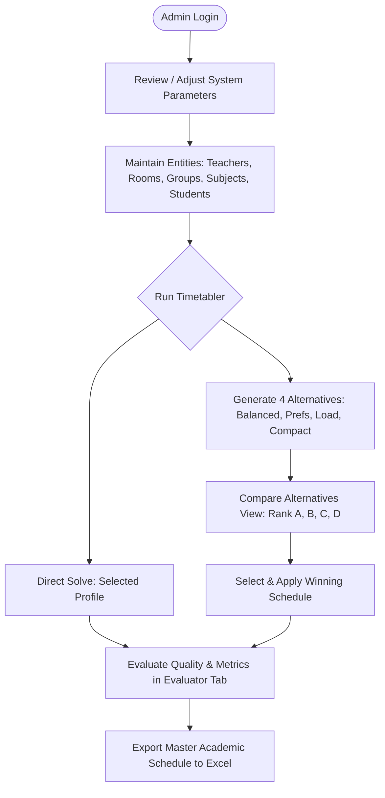
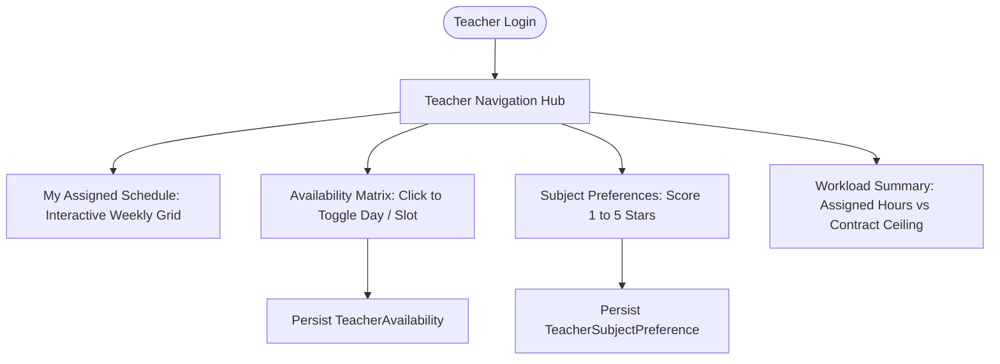
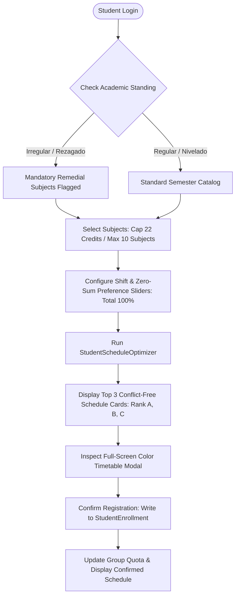

# System Workflows and Concurrency Architecture: OptiSchedule UMB

## 1. User Workflows by Role

OptiSchedule UMB implements tailored role-based views and state machines designed for three user classes: **Administrator**, **Teacher**, and **Student**.

---

### 1.1. Administrator Operational Workflow

The Administrator acts as the academic registrar, responsible for operational configuration, entity maintenance, timetable generation, and quality auditing.



1. **System Configuration:**
   - Navigates to System Configuration to update statutory contract hours (Full-time: 42h, Part-time: 21h, Cátedra: 23h), Saturday permissions, and registration date windows.
   - Adjusts the 5 global evaluator weights ($W_{\text{pref}}, W_{\text{gap}}, W_{\text{load}}, W_{\text{room}}, W_{\text{dist}}$).
2. **Master Entity Management (CRUD Tables):**
   - **Teachers:** Define contract types and academic knowledge areas (`knowledge_area`).
   - **Rooms:** Define room capacities and physical types (Normal, Laboratorio).
   - **Subjects:** Define credit values, weekly hours, semester associations, and knowledge areas.
   - **Groups:** Assign subjects, expected student counts, and inspect real-time availability badges (🟢 / 🟡 / 🔴).
   - **Students:** Manage enrollment eligibility, payment agreement flags (`has_payment_agreement`), regular/irregular status (`is_regular`), and owed remedial subjects (`pending_subject_ids`).
3. **Institutional Timetable Generation & Comparison:**
   - Administrator triggers the solver via the UI.
   - Under the **Solution Comparison View**, the administrator runs all 4 optimization profiles concurrently in a background worker (`AlternativesWorker`):
     - **Alternativa A (Equilibrada / Balanced)**
     - **Alternativa B (Máxima Afinidad / Preferences)**
     - **Alternativa C (Balance Docente / Load Balance)**
     - **Alternativa D (Horario Compacto / Compact)**
   - The UI displays comparison cards with badges indicating recommended solutions and metric scores.
   - Selecting a candidate card allows the administrator to commit the schedule to `ScheduleAssignment`.
4. **Excel Export:**
   - Generates an institutional multi-sheet `.xlsx` workbook featuring:
     - Master timetable grid.
     - Individual sheets partitioned per semester cohort.
     - Teacher-specific teaching assignments.

---

### 1.2. Teacher Operational Workflow

Teachers interact with the system to review their academic obligations and express pedagogical preferences.



1. **Assigned Schedule Review:**
   - Accesses an interactive 6-day (Monday-Saturday) timetable displaying scheduled subject groups, classroom numbers, and session hours.
2. **Availability Survey Submission:**
   - Visual grid where the teacher marks timeslots they are available to teach.
   - Blocks marked unavailable are excluded from the CP-SAT variable generation phase.
3. **Subject Preference Survey:**
   - Lists all academic subjects within the teacher's knowledge area.
   - The teacher assigns an affinity rating from 1 (Low) to 5 (High). Ratings directly feed CP-SAT objective terms and Evaluator metrics.
4. **Contractual Workload Monitoring:**
   - Displays real-time progress meters comparing assigned teaching hours against statutory ceilings (42h / 21h / 23h).

---

### 1.3. Student Enrollment Workflow

The student enrollment flow provides an automated, guided wizard for course registration.



1. **Standing & Remedial Verification:**
   - If `student.is_regular == False`, remedial subjects listed in `pending_subject_ids` are visually highlighted and prioritized.
2. **Curricular Selection & Credit Limit Validation:**
   - Dynamic real-time calculation of selected credits and course count.
   - If credits exceed 22 or subject count exceeds 10, the optimizer execution button is deactivated with an instructional error alert.
3. **Preference Weighting (Zero-Sum Sliders):**
   - The student chooses a primary preferred shift (`MAÑANA`, `TARDE`, `NOCHE`).
   - Three interactive sliders control optimization criteria:
     - **Shift Affinity Weight ($w_{\text{shift}}$)**
     - **Gap Minimization Weight ($w_{\text{gap}}$)**
     - **Free Days Weight ($w_{\text{free}}$)**
   - Sliders enforce a **strict 100% zero-sum rule**: adjusting one slider dynamically recalculates the others proportionally.
4. **Combinatorial Optimization & Card Presentation:**
   - `StudentScheduleOptimizer` searches conflict-free combinations.
   - Presents the top 3 optimal alternatives as interactive cards detailing:
     - Global Match Percentage (e.g., 94.5%)
     - Free Days count
     - Total Gap hours
     - Shift compliance
5. **Modal Timetable Inspection & Enrollment:**
   - Clicking a card launches a modal showing the exact weekly calendar.
   - Clicking **"Confirmar Matrícula"** clears prior student enrollments, inserts new `StudentEnrollment` records, decrements group availability quotas, and transitions the view to read-only confirmation.

---

## 2. Desktop Concurrency Architecture

### 2.1. Qt Event Loop Decoupling

Desktop applications built on PySide6 must never perform CPU-intensive combinatorial search or mathematical optimization on the GUI main thread, as this leads to OS application unresponsiveness ("Not Responding") and dropped paint events.

OptiSchedule UMB isolates all heavy algorithmic workloads into dedicated `QThread` workers:

```
[Main GUI Thread]                                     [QThread Background Worker]
       |                                                           |
       |-- User clicks "Generar Alternativas"                     |
       |-- Show loading overlay / progress bar                     |
       |-- worker = AlternativesWorker(db_params)                  |
       |-- worker.progress_updated.connect(self.on_progress)       |
       |-- worker.alternatives_ready.connect(self.on_ready)        |
       |-- worker.start() ---------------------------------------->|
       |                                                           |-- Instantiate ScheduleSolver
       |   (UI remains fluid and responsive)                       |-- Solve Profile 1: Balanced
       |<-- emit progress_updated(25, "Equilibrada...") -----------|
       |-- Update progress bar to 25%                              |-- Solve Profile 2: Preferences
       |<-- emit progress_updated(50, "Afinidades...") ------------|
       |-- Update progress bar to 50%                              |-- Solve Profile 3: Load Balance
       |<-- emit progress_updated(75, "Cargas...") ----------------|
       |-- Update progress bar to 75%                              |-- Solve Profile 4: Compact
       |<-- emit progress_updated(100, "Evaluando...") ------------|
       |                                                           |-- Run Evaluator on all 4
       |<-- emit alternatives_ready(results_dict) -----------------|
       |-- Hide progress overlay                                   |-- Thread finishes execution
       |-- Render comparison cards                                 V
       V
```

### 2.2. Worker Specifications

#### `SolverWorker` (`app/ui/workers/solver_worker.py`)
- **Execution Target:** Runs a single pass of `ScheduleSolver.solve()` for the active profile.
- **Signals:**
  - `progress(int, str)`: Broadcasts percentage (0-100%) and current operational phase.
  - `finished(dict)`: Transmits solver result payload containing assignment records and status description.
  - `error(str)`: Emitted in case of unhandled database or constraint exceptions.

#### `AlternativesWorker` (`app/ui/workers/alternatives_worker.py`)
- **Execution Target:** Sequentially generates and audits 4 schedule solutions across distinct objective weight profiles (`balanced`, `preferences`, `load_balance`, `compact`).
- **Signals:**
  - `progress(int, str)`: Notifies the comparison view of completion milestones (25%, 50%, 75%, 100%).
  - `finished(dict)`: Delivers an annotated dictionary containing evaluated scores and assignments for all 4 profiles, ranked from highest to lowest global score.
- **Card-Badge Independence Rule:** The worker cleanly decouples the profile focus title (e.g., `Alternativa Equilibrada`) from the comparative rank badge (`Alternativa A`, `Alternativa B`, `Alternativa C`, `Alternativa D`), ensuring visual coherence across the UI.

### 2.3. Thread-Safe Session Isolation

To guarantee database safety across worker threads:
1. Workers do NOT receive open SQLAlchemy sessions from the UI thread.
2. Workers invoke `SessionLocal()` inside their `run()` method to obtain a fresh connection from the engine.
3. The engine's `NullPool` architecture guarantees that connections are closed immediately upon session termination, preventing thread lockouts on SQLite files.
